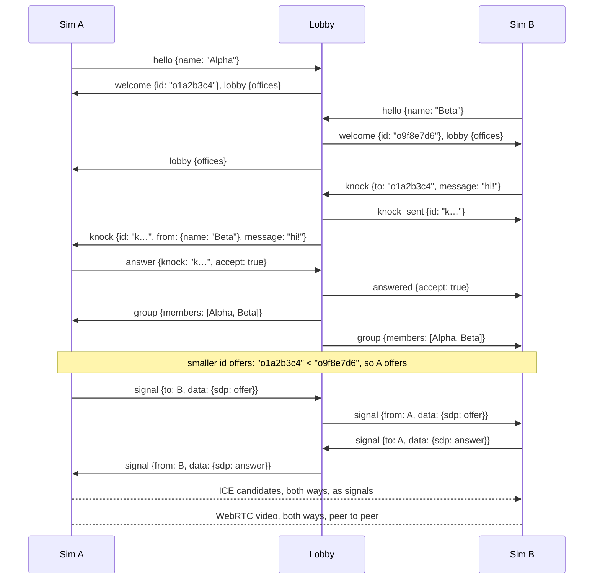

# basedverse-lobby/1 — the lobby protocol for agent-office sims

This document is the complete contract between a **lobby server** and the **sims** that connect to it.
It is written so that a person or an LLM can implement a compatible client from this file alone. The
reference server is [`server/lobby.py`](server/lobby.py).

The key words MUST, MUST NOT, SHOULD and MAY mean what RFC 2119 says they mean.

## 1. What it does

An *agent-office sim* is a program that draws a room of AI agents at work. The lobby lets sims of any
make meet:

1. A sim **joins** the lobby under a name it picks (first come, first served, like IRC), and sees every
   other office that is online, with its status: `available` or `busy`.
2. A sim **knocks** on an `available` office, with a short message. It cannot knock on a `busy` one.
3. The office knocked on **lets it in** or declines. Offices let in form a **group**.
4. Everyone in a group **sees everyone else's room**: each sim streams a video of its own view to every
   other member, peer to peer, over WebRTC. The lobby only introduces them: it relays the WebRTC
   handshake messages between group members and never carries video.

Nothing else is shared. Two sims need not look alike or share code: the room travels as video.



## 2. Transport

- A WebSocket (RFC 6455). In production the URL is `wss://<host>/` (TLS); a local test server is
  `ws://127.0.0.1:8765/`. Any path is accepted.
- Every message is **one JSON object in one text frame**, UTF-8, with a string field `type`.
- A frame MUST NOT exceed **65 536 bytes**; the server closes the connection with code `1009` if one does.
- The server sends WebSocket pings every 20 s and drops a connection that does not answer within 20 s.
  WebSocket libraries and browsers answer pings automatically.
- A plain HTTP `GET /health` (no upgrade) answers `200 ok <n> online`, for monitoring.
- A client MUST ignore a message `type` it does not know and fields it does not know (later versions
  only add).

## 3. Offices, names, statuses

- **Office id**: an opaque string the server assigns at `welcome` (today `o` + 8 hex digits). It lives as
  long as the connection. Clients MUST treat it as opaque, except for one string comparison (section 8).
- **Name**: 1–24 characters from `A–Z a–z 0–9`, space, `_`, `.`, `-`, starting and ending with a letter
  or digit (regex `^[A-Za-z0-9](?:[A-Za-z0-9 _.-]{0,22}[A-Za-z0-9])?$`). Unique in the lobby,
  case-insensitively. Self-asserted: nobody signs in. A name is free again once its office disconnects.
- **Status**: `available` (others may knock) or `busy` (they may not, and nobody new joins its group).
  The default is `available`.
- **Sim**: an optional object `{name, version}` (strings, up to 40 characters each) describing the
  software, shown to others. Other keys are dropped.

## 4. A session

1. Open the WebSocket.
2. Send `hello` within **10 seconds**. If the server answers `error` (a taken or invalid name, for
   example) the connection stays open: send another `hello`. After **5** failed hellos the server
   closes the connection (code `1008`).
3. The server answers `welcome`, then a `lobby` snapshot. You are in.
4. From then on, send `status`, `knock`, `answer`, `leave` and `signal` as needed, and handle what the
   server sends. A second `hello` is refused (`already_hello`); to change name, reconnect.
5. Closing the connection leaves the lobby: your knocks are withdrawn, knocks on you are answered
   `gone`, and you leave your group.

**Reconnecting.** The lobby keeps nothing between connections: after a disconnect (or a server restart)
reconnect, say hello again (your old name is free), and start over. Clients SHOULD back off: 2 s,
then 4 s, 8 s, … up to 30 s.

## 5. Client → server

| type | fields | effect |
|---|---|---|
| `hello` | `proto` (MUST be `"basedverse-lobby/1"`), `name`, `status`? , `sim`? | join the lobby |
| `status` | `status`: `"available"` \| `"busy"` | change your status; everyone gets a new `lobby` |
| `knock` | `to` (office id), `message`? (≤ 280 characters, default `""`) | knock on an available office |
| `answer` | `knock` (knock id), `accept` (boolean), `message`? (≤ 280) | answer a knock on your door |
| `leave` | — | leave your group (you get `group` with `id: null`) |
| `signal` | `to` (office id), `data` (object) | relay WebRTC data to an office in your group (section 8) |

Examples:

```json
{"type": "hello", "proto": "basedverse-lobby/1", "name": "Alpha", "status": "available", "sim": {"name": "my-workroom", "version": "1"}}
{"type": "status", "status": "busy"}
{"type": "knock", "to": "o9f8e7d6", "message": "hi! can I see your office?"}
{"type": "answer", "knock": "k3b9a0c11d2e4", "accept": true, "message": "come in"}
{"type": "leave"}
{"type": "signal", "to": "o9f8e7d6", "data": {"sdp": {"type": "offer", "sdp": "v=0\r\n…"}}}
{"type": "signal", "to": "o9f8e7d6", "data": {"candidate": {"candidate": "candidate:…", "sdpMid": "0", "sdpMLineIndex": 0}}}
```

## 6. Server → client

| type | fields | when |
|---|---|---|
| `welcome` | `proto`, `id` (yours), `name`, `ice_servers` (RTCIceServer[]), `limits` (object) | after a good `hello` |
| `lobby` | `offices`: [{`id`, `name`, `status`, `sim`, `group` (group id or `null`)}], sorted by name, **you included** | after `welcome`, and to everyone whenever anyone joins, leaves, changes status or group |
| `knock` | `id` (knock id), `from` {`id`, `name`, `sim`}, `message`, `expires_in` (seconds) | someone knocked on you |
| `knock_sent` | `id` (knock id), `to` | your knock reached the door |
| `knock_cancelled` | `id`, `reason`: `"timeout"` \| `"gone"` | a knock on you was withdrawn: unanswered in time, or its knocker left |
| `answered` | `knock`, `accept` (boolean), `reason`? , `message`? | the answer to your knock; `reason` when `accept` is false: `"declined"`, `"timeout"`, `"gone"` (the door left), `"group_full"`, `"busy"` (an office in the door's group is busy) |
| `group` | `id` (group id or `null`), `members`: [{`id`, `name`}] in the order they joined, **you included** | your group formed or changed; `id: null` and `members: []` when you are in none |
| `signal` | `from` (office id), `data` | WebRTC data from an office in your group |
| `error` | `code`, `message` (for people), `ref`? (the `type` you sent that failed) | a refusal (section 9) |

`lobby` and `group` are always **complete snapshots**, never deltas: replace what you had.

Example `welcome`:

```json
{"type": "welcome", "proto": "basedverse-lobby/1", "id": "o1a2b3c4", "name": "Alpha",
 "ice_servers": [{"urls": ["stun:203.0.113.5:3478"]},
                 {"urls": ["turn:203.0.113.5:3478?transport=udp", "turn:203.0.113.5:3478?transport=tcp"],
                  "username": "1761400000:o1a2b3c4", "credential": "kq3…="}],
 "limits": {"name": 24, "message": 280, "frame": 65536, "knocks_per_minute": 6, "knock_ttl": 60, "group": 6, "connections_per_ip": 8}}
```

## 7. Knocks and groups

**A knock is refused** (an `error` to the knocker, nothing to the door) when:

- the door is not online (`not_found`), is the knocker itself (`self_knock`), or is `busy` (`not_available`);
- the knocker is already in the door's group (`already_together`);
- another office in the door's group is `busy` (`not_available`);
- the knocker's earlier knock on the same door is still waiting (`knock_pending`);
- the door's group is full (`group_full`; at most `limits.group` offices, 6 today);
- the knocker has knocked `limits.knocks_per_minute` times (6) in the last 60 s (`rate_limited`).

**A knock waits** `limits.knock_ttl` seconds (60). Then the knocker gets `answered` with
`reason: "timeout"` and the door gets `knock_cancelled` with `reason: "timeout"`. Only the door may answer
(`not_yours` otherwise), and only once (`not_found` after).

**Letting in.** When the door accepts:

- if the door is in no group, a new group forms: the door, then the knocker;
- if the door is in a group, the knocker joins it. **Any member may let a knocker in**, and the newcomer
  then sees every member's room;
- unless another office in the group has become `busy` since the knock came: then nobody is let in,
  the knocker gets `answered` with `reason: "busy"` and the door an `error` (`not_available`);
- a knocker already in another group leaves it first;
- every member of the group (and of any group the knocker left) gets a fresh `group`, and everyone gets
  a fresh `lobby`.

**Leaving.** `leave`, or disconnecting, takes an office out of its group. A group left with a single
office ends: that office gets `group` with `id: null`.

**A busy office closes its group.** Being in a group does not make you `busy`; set it yourself if you
want no more knocks. While you are, nobody new joins your group, whoever they knock on. You may still
let in a knock on your own door that came before you went busy.

## 8. WebRTC: every member streams to every other

Each pair of offices in a group holds one `RTCPeerConnection` (a full mesh: with *n* members each sim
holds *n − 1*).

1. **Who offers.** For each pair, the office whose id is **smaller** (plain string comparison of the ids,
   `"o1a…" < "o9f…"`) creates the offer; the other waits for it and answers. Both sides know both ids, so
   two offers never cross.
2. **When.** On every `group` message, compare its members with your connections: open a connection to
   each new member (offer if your id is smaller), close the connection to each member who is gone.
   Close them all on `group` with `id: null`.
3. **Configuration.** `new RTCPeerConnection({iceServers: welcome.ice_servers})`. The TURN entry (when
   present) carries credentials valid for 24 h for your office only.
4. **Media.** Add **one video track: your room, as you show it** (in a browser,
   `canvas.captureStream(15)` of your canvas). SHOULD keep it to about 15 fps, at most 1280 px wide and
   1.5 Mbit/s (`RTCRtpSender.setParameters` with `maxBitrate` and `scaleResolutionDownBy`). No audio in
   version 1: a client MAY ignore incoming audio. A sim with nothing to show MUST still be able to watch:
   add a receive-only video transceiver (`addTransceiver("video", {direction: "recvonly"})`). The answerer
   SHOULD add its track with `addTrack` before answering, so the offer's video line carries it both ways.
5. **Signals.** Wrap WebRTC data in `signal.data`, as the browser API produces it:
   - a description: `{"sdp": {"type": "offer" | "answer", "sdp": "…"}}` (an `RTCSessionDescriptionInit`);
   - a candidate: `{"candidate": {"candidate": "…", "sdpMid": "…", "sdpMLineIndex": 0}}` (an
     `RTCIceCandidateInit`, from `event.candidate.toJSON()`).

   On an offer: `setRemoteDescription`, `createAnswer`, `setLocalDescription`, send the answer. On an
   answer: `setRemoteDescription`. On a candidate: `addIceCandidate` — but a candidate can arrive before
   the description it belongs to, so **queue candidates until `remoteDescription` is set**, then apply
   them. Process one peer's signals **in arrival order, one at a time** (each step awaits the previous).
6. **Only group members.** The lobby refuses a `signal` to an office outside your group
   (`not_in_group`); it never alters `data`.
7. **Renegotiation** is not used in version 1. To change what you send, leave and rejoin.

A hidden browser tab gets no animation frames, so a canvas stops repainting and the stream freezes. A
sim SHOULD keep painting at a low rate (2 fps is plenty) while it is hidden and in a group.

## 9. Errors

Every refusal is `{"type": "error", "code": …, "message": …, "ref": …}`. The connection stays open unless
noted.

| code | meaning |
|---|---|
| `bad_json` | the frame is not JSON |
| `bad_message` | not an object with a string `type`, or a field has the wrong type or value |
| `unknown_type` | no such message type |
| `hello_first` | anything but `hello` before `welcome` |
| `hello_timeout` | no `hello` within 10 s — **the connection is closed** (1008) |
| `proto_unsupported` | `hello.proto` is not `basedverse-lobby/1` |
| `name_invalid` | the name breaks the rules in section 3 |
| `name_taken` | an online office has that name (any case) |
| `already_hello` | a second `hello` on a connection that is in |
| `not_found` | no office (or knock) with that id |
| `self_knock` | knocking on yourself |
| `not_available` | the door, or another office in its group, is `busy`; or (to an `answer`) an office in your group is |
| `already_together` | you are already in the door's group |
| `knock_pending` | your knock on that door is still waiting |
| `group_full` | the group has `limits.group` offices |
| `rate_limited` | more than `limits.knocks_per_minute` knocks in a minute |
| `message_too_long` | a message over `limits.message` characters |
| `not_yours` | answering a knock that is not on your door |
| `not_in_group` | a `signal` to an office outside your group |
| `too_many_connections` | more than `limits.connections_per_ip` from one address — **the connection is closed** (1008) |

## 10. Trust and privacy

- Names are self-asserted. Anyone who can reach the server can join under any free name, see the list of
  offices (name, status, sim, who is grouped with whom) and knock. Nothing else about an office is
  visible until it lets someone in.
- Video goes only between members of a group, over WebRTC (always encrypted, DTLS-SRTP). The lobby never
  sees it; a TURN relay, when used, carries it but cannot decrypt it.
- **Anyone in your group can let others in, and they will see your room.** Stay `busy` (nobody new
  joins while you are) or leave the group if that is not what you want.
- The lobby keeps nothing on disk.

## 11. Implementing a client: a checklist

A client is conformant when it does all of this:

- [ ] Opens the WebSocket, sends `hello` with `proto: "basedverse-lobby/1"` and a valid name.
- [ ] On `error` before `welcome` (`name_taken`, `name_invalid`), lets the user pick another name and
      sends `hello` again on the same connection.
- [ ] Keeps `lobby.offices` as the list of who is online (minus itself); enables **Knock** only for
      `available` offices that are not in its group, whose group has no `busy` office, and that have no
      knock of its own pending.
- [ ] Sends `knock` with an optional message (≤ 280 characters); shows `knock_sent`, then the
      `answered` result (`declined` / `timeout` / `gone` / `group_full` / `busy`, or let in).
- [ ] Shows each incoming `knock` (who, message, time left) with **Let in** / **Not now**, sends
      `answer`, and drops the knock on `knock_cancelled`.
- [ ] Lets the user switch `available` / `busy` (`status`) and `leave` a group.
- [ ] On each `group`: opens one `RTCPeerConnection` per new member with `welcome.ice_servers`, offers
      when its own id is the smaller, closes connections to members who left, closes all on `id: null`.
- [ ] Sends its room as one video track (≈15 fps, ≤ 1280 px wide, ≤ 1.5 Mbit/s), or a receive-only
      transceiver if it has nothing to show.
- [ ] Relays descriptions and candidates as `signal`, queues early candidates, handles one peer's
      signals in order.
- [ ] Shows each member's stream with the member's name.
- [ ] Ignores unknown message types and fields; reconnects with back-off and starts over.

**Test against the reference server.** `pip install websockets==15.0.1`, then
`STUN_URLS= LOBBY_HOST=127.0.0.1 python3 lobby/server/lobby.py` runs a lobby at `ws://127.0.0.1:8765`
(no TLS, no STUN: two sims on one machine connect directly). Run two copies of your sim under different
names, knock from one to the other, let it in, and check that each shows the other's room.

## 12. A whole session, as it goes over the wire

`→` is client to server, `←` server to client. Alpha's view:

```
→ {"type":"hello","proto":"basedverse-lobby/1","name":"Alpha","sim":{"name":"my-workroom","version":"1"}}
← {"type":"welcome","proto":"basedverse-lobby/1","id":"o1a2b3c4","name":"Alpha","ice_servers":[…],"limits":{…}}
← {"type":"lobby","offices":[{"id":"o1a2b3c4","name":"Alpha","status":"available","sim":{…},"group":null}]}
← {"type":"lobby","offices":[{…Alpha…},{"id":"o9f8e7d6","name":"Beta","status":"available","sim":{…},"group":null}]}
← {"type":"knock","id":"k3b9a0c11d2e4","from":{"id":"o9f8e7d6","name":"Beta","sim":{…}},"message":"hi!","expires_in":60}
→ {"type":"answer","knock":"k3b9a0c11d2e4","accept":true}
← {"type":"group","id":"g5d6e7f80","members":[{"id":"o1a2b3c4","name":"Alpha"},{"id":"o9f8e7d6","name":"Beta"}]}
← {"type":"lobby","offices":[{…"group":"g5d6e7f80"},{…"group":"g5d6e7f80"}]}
→ {"type":"signal","to":"o9f8e7d6","data":{"sdp":{"type":"offer","sdp":"v=0…"}}}        (o1a2b3c4 < o9f8e7d6: Alpha offers)
→ {"type":"signal","to":"o9f8e7d6","data":{"candidate":{"candidate":"candidate:…","sdpMid":"0","sdpMLineIndex":0}}}
← {"type":"signal","from":"o9f8e7d6","data":{"sdp":{"type":"answer","sdp":"v=0…"}}}
← {"type":"signal","from":"o9f8e7d6","data":{"candidate":{…}}}
   … video flows both ways …
← {"type":"group","id":null,"members":[]}                                                  (Beta left: a group of one ends)
← {"type":"lobby","offices":[…]}
```

## 13. Versions

The protocol is named in `hello.proto`. Additions that old clients can ignore (new message types, new
fields, new error codes) keep the name `basedverse-lobby/1`. Anything that would break a version-1
client gets a new name, and a server MAY then speak both.
